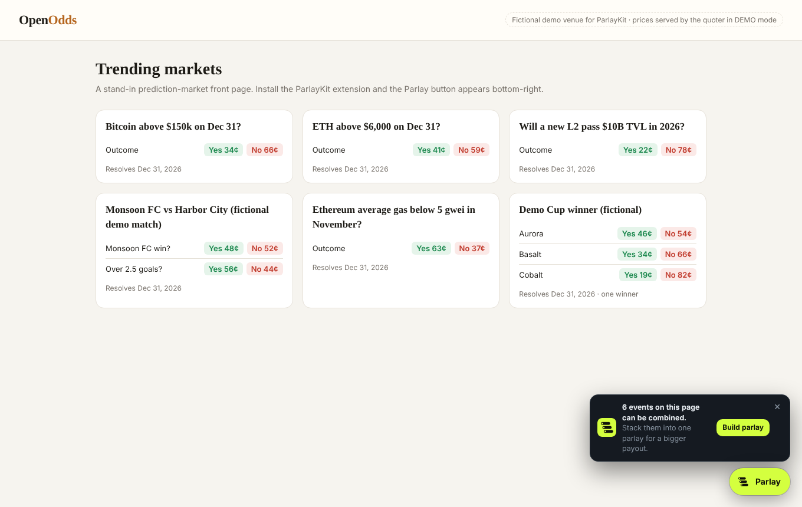
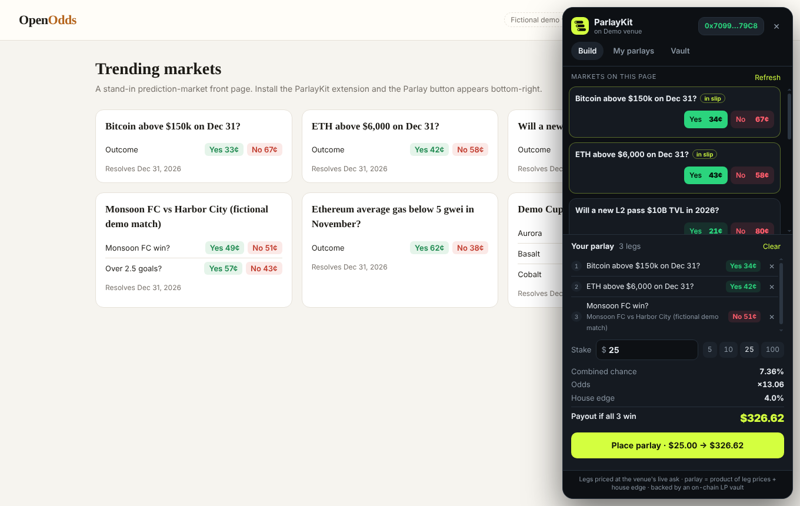
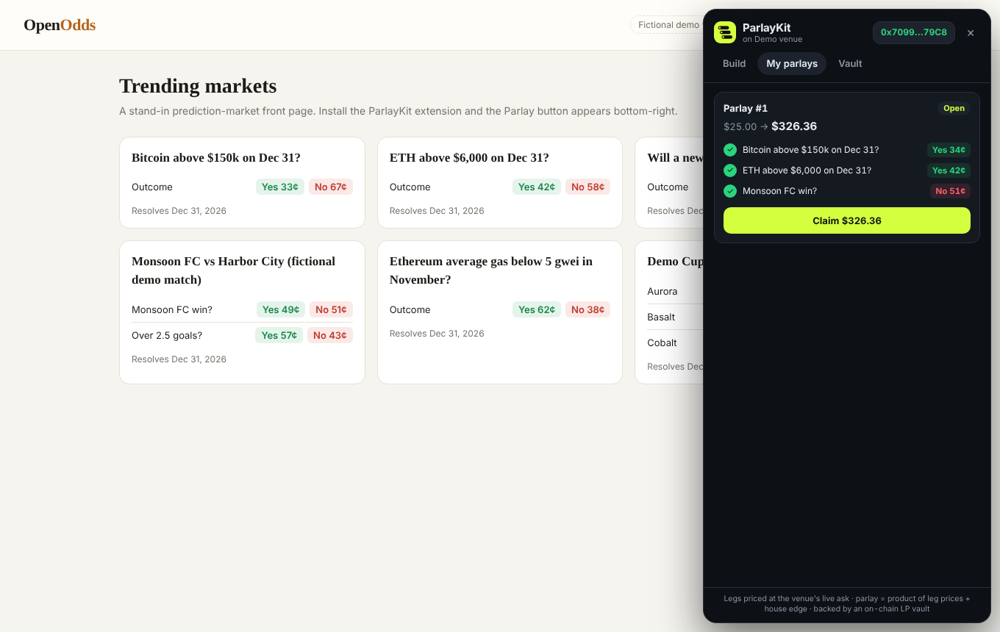
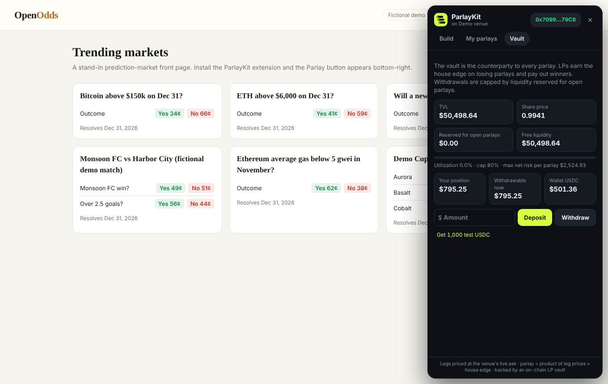
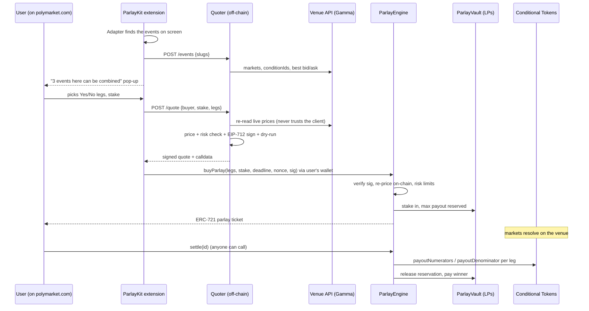

# ParlayKit

**One-click parlays on the prediction markets you already use.**

ParlayKit is a browser extension that sits on top of Polymarket (and any CTF-based venue). It reads the markets you can see on the page, pops up an offer to combine them, prices the combined bet live, and sells it to you as an on-chain parlay. The counterparty is an ERC-4626 vault that anyone can provide liquidity to. Settlement is permissionless: it reads the same Conditional Tokens resolution that Polymarket itself pays out from.

> Built at ETHGlobal Mumbai 2026 · Classic track · testnet MVP, **not audited**

| Offer pop-up | Build a parlay | Claim | LP vault |
|---|---|---|---|
|  |  |  |  |

---

## Why

Prediction markets are single-event. If you think *BTC > $150k* **and** *ETH > $6k* **and** *gas stays low*, today you have to buy three positions and you get three separate small payouts. Sportsbooks solved this decades ago with parlays. Prediction markets mostly don't offer them, because listing every combination fragments liquidity and blows up market-maker risk (the problem the [ParlayMarket paper](https://arxiv.org/abs/2603.22596) addresses).

ParlayKit adds parlays **without asking the venue to change anything**:

- **No new markets to list.** Legs are existing markets, identified by their CTF `conditionId`.
- **One pool backs every combination.** The LP vault is the house for any parlay of any markets.
- **Trust-minimized settlement.** The engine reads `payoutNumerators`/`payoutDenominator` from the Conditional Tokens contract, the same oracle output Polymarket pays out from.

## How it works



### Pricing (v1)

All integer math is identical in `ParlayEngine.quotePayout()` and `quoter/src/pricing.js`, so the number in the extension is exactly what the contract pays.

| | |
|---|---|
| Leg price `pᵢ` | live **best ask** of the chosen outcome on the venue (what buying that leg alone would cost). YES = `bestAsk`, NO = `1 − bestBid` |
| Fair parlay price | `fair = Π pᵢ` (independence) |
| House edge | `edge = 2% + 1% × (n − 1)` (more legs mean more model risk) |
| Offer price | `offer = fair × (1 + edge)` |
| Payout | `maxPayout = stake / offer` |

Example: legs at 50¢, 40¢ and 80¢ give fair = 16%, a 4% edge, offer = 16.64%, so **10 USDC pays 60.10 USDC**. This vector is checked by both the Foundry and the Node tests.

**Correlation guard:** v1 allows **one leg per event**. Markets inside one event are usually mutually exclusive or correlated, and independence would misprice them. The quoter rejects them, the UI disables them, and the engine rejects duplicate markets.

### v2: ParlayMarket pricing

The [ParlayMarket paper](https://arxiv.org/abs/2603.22596) (Rana, Nadkarni, Moshrefi, Viswanath, 2026) keeps one shared pairwise exponential-family belief state. Every base and parlay price is a marginal of that model, and trades update it online. That is how one pool can support exponentially many parlays with loss bounded quadratically in the number of base markets. v1 is the independence special case (all pairwise couplings = 0). The upgrade path is local:

- `quoter/src/pricing.js → correlationAdjust()`: replace with the pairwise-model joint marginal.
- Feed every parlay fill back as an observation (parlay trades are what identify the correlations).
- Relax the one-leg-per-event rule once correlated legs are priced coherently.

The contract already accepts a signed per-leg price vector, so the on-chain side doesn't change.

### Risk & LP accounting (`ParlayVault`)

- **ERC-4626** over USDC. LPs get `pkUSDC` shares.
- `pendingPremium` holds stakes of open parlays. They are **excluded** from `totalAssets()` until settlement, so share price only moves when outcomes are known.
- `lockedPayout` is the sum of max payouts of open parlays. LP withdrawals are capped at `freeLiquidity = balance − lockedPayout`, so winners can always be paid.
- Per-parlay limit: net risk `(payout − stake) ≤ 5%` of free liquidity.
- Global limit: `lockedPayout ≤ 80%` of vault balance.
- Leg prices must be between 2¢ and 98¢. Quotes expire after 90s and each nonce is single-use, bound to the buyer.

### Settlement

`settle(id)` is permissionless. For each leg it reads the CTF payout vector:

```
finalPayout = maxPayout × Π (numeratorᵢ / denominatorᵢ)
```

- every leg won: full payout, sent to the **current ticket holder** (tickets are transferable ERC-721s)
- any leg lost: the parlay can be settled **immediately**, even before the other legs resolve, and LPs earn the stake
- 50/50 market: that leg pays half, exactly as the underlying market does

On Polygon mainnet the engine points at Polymarket's real CTF (`0x4D97DCd97eC945f40cF65F87097ACe5EA0476045`). On testnet, `MockConditionalTokens` exposes the same getters and the team mirrors resolutions with `quoter/scripts/resolve.js`.

## Repo layout

```
contracts/   Foundry: ParlayEngine, ParlayVault, mocks, tests, deploy script
quoter/      Node service: venue adapters, pricing, EIP-712 signing, calldata, vault/parlay views
extension/   Chrome MV3 extension: site adapters, parlay slip, wallet bridge, vault + my-parlays tabs
demo/        Fictional "OpenOdds" venue page for offline demos and local testing
scripts/     dev.sh: one-command local stack
```

## Run it locally (5 min)

Requirements: Foundry, Node 18+, Python 3, Chrome.

```bash
./scripts/dev.sh
```

This starts anvil, deploys everything (seeding the vault with 50k test USDC), starts the quoter in DEMO mode on `:8787` and serves the demo venue on `:5173`.

1. Chrome → `chrome://extensions` → Developer mode → **Load unpacked** → select `extension/`.
2. Open `http://127.0.0.1:5173/?devwallet=1`. The dev wallet routes to an unlocked anvil account, so MetaMask isn't needed locally.
3. The pop-up offers a parlay. Pick 3 legs, use **Vault → Get test USDC**, then **Place parlay**.
4. Resolve legs and claim:
   ```bash
   cd quoter
   CHAIN_ID=31337 QUOTER_PRIVATE_KEY=0x2a871d0798f97d79848a013d4936a73bf4cc922c825d33c1cf7073dff6d409c6 \
   ADMIN_PRIVATE_KEY=0xac0974bec39a17e36ba4a6b4d238ff944bacb478cbed5efcae784d7bf4f2ff80 \
   node scripts/resolve.js btc-150k yes
   ```
   Then open **My parlays → Claim**.

## Run it on Polygon Amoy with real Polymarket markets

```bash
# 1. keys
cd quoter && npm install && npm run keygen    # -> QUOTER_PRIVATE_KEY + QUOTE_SIGNER
# fund your deployer with Amoy POL from a faucet

# 2. deploy (MockUSDC with public faucet + MockConditionalTokens)
cd ../contracts
forge install OpenZeppelin/openzeppelin-contracts@v5.1.0 foundry-rs/forge-std --no-git
PRIVATE_KEY=0x<deployer> QUOTE_SIGNER=0x<from keygen> SEED_LIQUIDITY=50000000000 \
  forge script script/Deploy.s.sol --rpc-url https://rpc-amoy.polygon.technology --broadcast
# -> contracts/deployments/80002.json

# 3. quoter
cd ../quoter && cp .env.example .env   # fill QUOTER_PRIVATE_KEY, ADMIN_PRIVATE_KEY (= deployer)
npm start
```

Load the extension, open any `polymarket.com` page and the Parlay button appears. Legs use **real Polymarket conditionIds and live order-book prices**, and stakes are test USDC (**Vault → Get test USDC**). To settle, mirror the real outcome onto the mock CTF:

```bash
node scripts/resolve.js 0x<conditionId> yes|no|split
```

For production on Polygon mainnet, deploy with `USDC=<USDC.e>` and `CTF=0x4D97DCd97eC945f40cF65F87097ACe5EA0476045`. Settlement then needs no resolver at all. Get an audit and legal review first (see Limitations).

## Tests

```bash
cd contracts && forge test        # 14 tests: pricing, signatures, replay, risk limits, settlement, 50/50, transfers, vault caps, fuzz
cd quoter && npm test             # pricing parity with the contract, Gamma normalization, guards
cd quoter && npm run e2e          # against a running local stack: LP deposit -> buy -> forged-sig revert -> resolve -> claim
```

## Extension: supported sites

| Site | Status |
|---|---|
| polymarket.com | Event pages and listing pages. Every `/event/<slug>` visible on screen becomes a candidate leg |
| Demo venue (`127.0.0.1`) | Full flow, fictional markets |
| 1inch | Adapter stub. We couldn't confirm a public 1inch prediction-market UI at build time. If its markets are CTF/Polymarket-backed, only the DOM selectors in `extension/adapters.js` need to change |

Adding a venue means one adapter in `extension/adapters.js` (find slugs on the page) plus one source in `quoter/src/sources/` (slug → markets with conditionIds and prices).

## Limitations (honest list)

- **Trusted quoter.** Prices come from a signed off-chain quote. The engine re-prices and enforces bounds on-chain, but a compromised signer could quote stale prices within those bounds. Next steps: multiple signers, a price-deviation check against an on-chain TWAP, and a signer rotation timelock.
- **Independence pricing.** Correlated legs across *different* events (e.g. two markets that depend on the same match) are still priced as independent. The house edge partly covers this. ParlayMarket pricing is the real fix.
- **Admin powers.** The owner can change parameters, rotate the signer and `voidParlay` (refund) cancelled markets. All of this should move to a timelock or multisig.
- **LP timing.** Between a market resolving and someone calling `settle()`, an LP could withdraw ahead of a known win, or deposit ahead of a known loss. Mitigations: a keeper that settles on resolution, a withdrawal cooldown, or marking resolved legs to market in `totalAssets()`.
- **No hedging.** The vault carries the risk directly. A natural extension is to hedge large parlays by buying legs on the venue.
- Testnet only, unaudited. Parlay products may be regulated as gambling in many jurisdictions.
